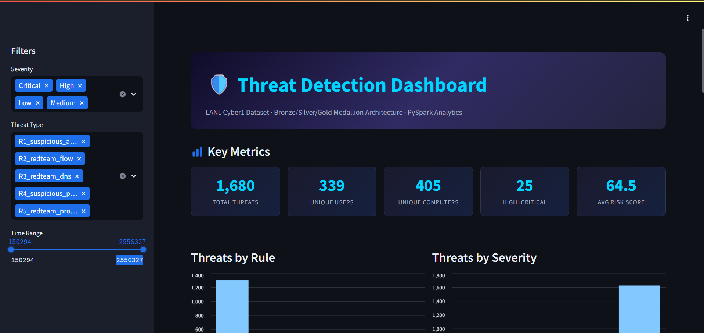
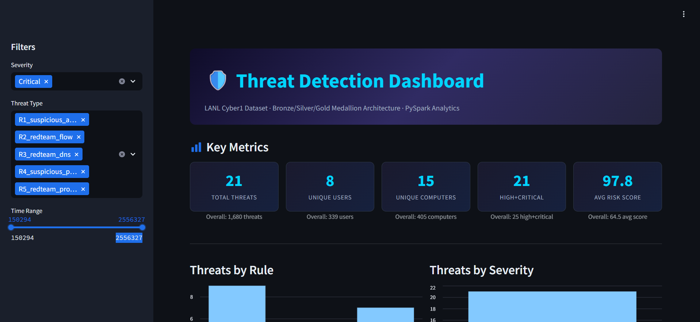
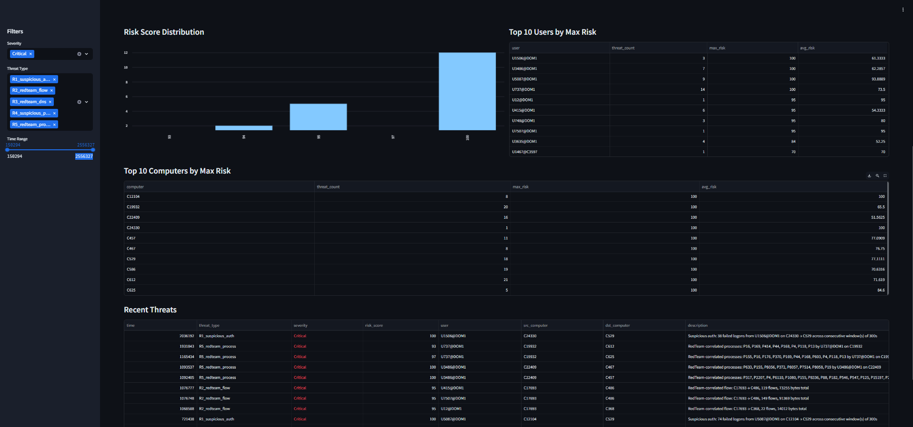

# Cybersecurity Threat Detection Platform

Production-ready end-to-end cybersecurity threat detection and analytics platform analyzing the **LANL Cyber1 Unified Host and Network Dataset** using **Apache PySpark**, a **Bronze / Silver / Gold Medallion Architecture**, and an interactive **Streamlit Dashboard**.
| | |
|---|---|
| **Live dashboard** | [Open the dashboard](https://cybersecurity-threat-platform.streamlit.app/) |
| **Source code** | [GitHub repository](https://github.com/DivyaKarotra/cybersecurity-threat-platform) |
| **Dataset** | LANL Cyber1 (Los Alamos National Laboratory) |
| **Stack** | PySpark, Parquet, Streamlit, pytest |
---

## Architecture Overview

```
Raw .gz Data (LANL Cyber1)
      │
      ├──> [Inspect Stage] (Streamed header/time verification)
      │
      ├──> [Sample Stage] (Tier-1 key-matched & Tier-2 baseline)
      │
      ├──> Bronze Layer (Typed raw Parquet via PySpark, explicit schemas, ? → NULL)
      │
      ├──> Silver Layer (Cleaned & typed, snake_case, uppercase trimmed join keys, dropped nulls)
      │
      ├──> Threat Detection Rules (R1–R5, unified schema, risk scoring & severity)
      │
      ├──> Combine Stage (unionByName, deduplication on core identity, NULL validation)
      │
      ├──> Gold Layer (Parquet analytics: all_threats, summary, high_risk, statistics, profiles)
      │
      ├──> Validation Engine (validate.py, shared compute_statistics, reconciliation)
      │
      └──> Dashboard (Streamlit UI via pandas/pyarrow, real-time filtering & KPIs)
```

---

## Dataset and Attribution

Based on the **[Los Alamos National Laboratory (LANL) Comprehensive Multi-Source Cyber-Security Events (Cyber1)](https://csr.lanl.gov/data/2017/)**:
- **auth.txt.gz**: Authentication logons/logoffs (time, src/dst user, src/dst computer, auth type, logon type, success/failure).
- **dns.txt.gz**: DNS resolution records (time, src_computer, resolved_computer).
- **flows.txt.gz**: Network flow traffic (time, duration, src_computer, src_port, dst_computer, dst_port, protocol, packet_count, byte_count).
- **proc.txt.gz**: Process lifecycle events (time, user, computer, process_name, start/end).
- **redteam.txt.gz**: Labeled Red Team compromise events ground truth (time, user, src_computer, dst_computer).

*Citation*: Kent, A. D. (2015). *Comprehensive, Multi-Source Cyber-Security Events*. Los Alamos National Laboratory. https://csr.lanl.gov/data/2017/

*Data Characteristics*: Comma-delimited, headerless, timestamps represented as integer seconds from dataset start (`t=1`), missing fields encoded as `?`.

> [!IMPORTANT]
> **Raw Data Notice**: Raw dataset files are not included in this repository due to size constraints (>12 GB compressed, >100 GB uncompressed) and must be downloaded separately from the official LANL Cyber1 repository. For immediate standalone dashboard exploration without downloading or re-processing raw data, precomputed analytics are bundled in `dashboard_data/`.

---

## Medallion Layers

| Layer | Path | Description & Schema |
|---|---|---|
| **Raw** | `data/raw/` | Source `.txt.gz` files from LANL. |
| **Sample** | `data/sample/` | Time-windowed CSV samples (Tier-1 compromise-aligned, Tier-2 baseline). |
| **Bronze** | `data/bronze/` | Typed raw Parquet ingested per source using explicit `StructType` schemas; `?` mapped to `null`. Zero dropped rows. |
| **Silver** | `data/silver/` | Normalized Parquet: snake_case column names, uppercase trimmed join keys (`user_key`, `src_computer_key`, `dst_computer_key`), boolean flags (`is_failure`), strict reconciliation checks (`kept + dropped == bronze`). |
| **Gold** | `data/gold/` | Analytical reporting tables: `all_threats`, `summary_by_type`, `summary_by_severity`, `high_risk`, `statistics`, `user_risk`, `computer_risk`, plus per-source summary tables (`flow_totals`, `flow_by_protocol`, `flow_top_pairs`, `flow_high_volume`, `auth_summary`, `auth_by_type`, `dns_summary`, `process_summary`, `redteam_description`). |

---

## Threat Detection Rules (R1–R5)

All detection rules emit a unified schema (`THREAT_SCHEMA`):
`[time: long, user: string, src_computer: string, dst_computer: string, threat_type: string, severity: string, risk_score: int, failed_attempts: long, event_count: long, description: string]`

| Rule | Name | Matching Logic & Conditions |
|---|---|---|
| **R1** | Suspicious Authentication | Behavioural brute-force anomaly detection: flags user accounts with $\ge 20$ failed authentications (percentile-based threshold $\ge \max(20, \text{p95})$ where $\text{p95}=9, \text{p99}=19$) for the same `(src_user, src_computer, dst_computer)` within a 300s tumbling window. Machine accounts (`user_key` ending in `$`, e.g. `C...$@DOM1` or `COMP1$`) and `ANONYMOUS LOGON` accounts are explicitly excluded. Consecutive sliding windows are merged using island-gap grouping into single consolidated detections (first-event time, summed event count). Corroborated with Red Team activity for score bonus (+25); uncorroborated detections are capped at Medium severity ($\le 69$). |
| **R2** | Red Team Flow Correlation | Correlates network flows with known Red Team events where `flows.src_computer_key == redteam.src_computer_key` and `flows.dst_computer_key == redteam.dst_computer_key` within a $\pm 300\text{s}$ window. |
| **R3** | Red Team DNS Activity | Correlates DNS queries originating from a compromised `redteam.src_computer_key` within a $\pm 300\text{s}$ temporal window. |
| **R4** | Suspicious Process Frequency | Statistical anomaly detection: flags user process executions on computers where frequency exceeds $\mu + 3\sigma$ of baseline computer behavior. Widespread benign background processes (appearing on $\ge 50$ hosts) are excluded to prevent false alarms. Minimum execution count $\ge 5$. |
| **R5** | Red Team Process Execution | Correlates process creation by a known Red Team user on a compromised host (`proc.user_key == redteam.user_key` and `proc.computer_key == redteam.src_computer_key`) within $\pm 300\text{s}$. |

### Risk Scoring & Severity Mapping

Configured and computed dynamically:
$$\text{Score} = \min\left(100, \text{Base} + \text{Bonus}_{\text{failures}} + \text{Bonus}_{\text{events}} + \text{Bonus}_{\text{RedTeam}}\right)$$

- **Base Scores**: R1 = 40, R2 = 70, R3 = 55, R4 = 35, R5 = 75
- **Failure Bonus**: $\min(20, \text{failed\_attempts} \times 2)$
- **Volume Bonus**: $\min(15, (\text{event\_count} - 1) \times 1)$
- **Red Team Bonus**: +10 for ground-truth rules (R2, R3, R5); +25 for Red Team corroborated R1.
- **Severity Capping**: Uncorroborated R1 detections are strictly capped at Medium severity (score $\le 69$). High and Critical severities are reserved exclusively for Red Team correlated or corroborated detections.
- **Severity Tiers**:
  - `Low`: 0 – 39
  - `Medium`: 40 – 69
  - `High`: 70 – 89
  - `Critical`: 90 – 100

---

## Output Folders

```
cybersecurity-threat-platform/
├── dashboard_data/           # Bundled dashboard analytical parquet (threats + stats, <25 MB)
├── data/
│   ├── sample/               # Sampled CSV files
│   ├── bronze/               # Bronze Parquet tables (auth, dns, flows, proc, redteam)
│   ├── silver/               # Silver typed & normalized Parquet
│   └── gold/                 # Final analytics Parquet tables
│       ├── all_threats/      # Unified threat detections (1,680 rows)
│       ├── summary_by_type/  # Threat counts and risk stats by rule
│       ├── summary_by_severity/ # Threat counts by severity
│       ├── high_risk/        # Threats with risk_score >= 70 (25 rows)
│       ├── statistics/       # JSON metadata and KPI counts (part-0.parquet)
│       ├── user_risk/        # Per-user aggregated threat & risk profile
│       ├── computer_risk/    # Per-computer aggregated threat & risk profile
│       ├── flow_totals/      # Aggregate packet/byte statistics
│       ├── flow_by_protocol/ # Traffic volume by network protocol
│       ├── flow_top_pairs/   # Top 100 communicating computer pairs
│       ├── flow_high_volume/ # Flows exceeding volume threshold
│       ├── auth_summary/     # Authentication success vs failure breakdown
│       ├── auth_by_type/     # Auth logon type distribution
│       ├── dns_summary/      # Top DNS querying computers
│       ├── process_summary/  # Process execution frequencies across fleet
│       └── redteam_description/ # Timeline of ground-truth compromise events
└── logs/                     # Detailed execution logs for each pipeline stage
```

---

## Setup & Execution (Windows PowerShell)

### 1. Environment & Prerequisites
- Windows 10/11 with PowerShell 5.1+ / 7+
- Python 3.12 (Tested and Recommended; Python 3.11/3.12 tested with 24/24 pytest pass and complete pipeline run)
- OpenJDK 21+ (`JAVA_HOME` configured)
- Modern PySpark 3.5.4 (runs in local mode without requiring manual Hadoop winutils binaries)

```powershell
cd "cybersecurity-threat-platform"
# Create virtual environment with Python 3.12:
py -3.12 -m venv venv311
.\venv311\Scripts\Activate.ps1
pip install -r requirements.txt
```

### 2. Running the Pipeline End-to-End
Run the complete pipeline (inspect → bronze → silver → analytics → 5 rules → combine → gold → validate) skipping sampling (sample files are pre-generated):

```powershell
.\venv311\Scripts\python.exe run_pipeline.py --skip-sample
```

To run an individual stage:
```powershell
.\venv311\Scripts\python.exe run_pipeline.py --stage gold
.\venv311\Scripts\python.exe run_pipeline.py --stage rule_R1
```

### 3. Running Validation Independently
The validation suite reads back the Gold layer, verifies schema, verifies 0 duplicates, checks 0 unexpected nulls, reconciles statistics, and checks Bronze/Silver row integrity:

```powershell
.\venv311\Scripts\python.exe src/utils/validate.py
```

### 4. Running the Pytest Test Suite
Execute the 24 automated unit and integration tests:

```powershell
.\venv311\Scripts\pytest -v
```

### 5. Launching the Streamlit Dashboard
Launch the web interface (reads Gold directly via Pandas and PyArrow, no Spark overhead):

```powershell
.\venv311\Scripts\streamlit run dashboard/app.py
```
Open `http://localhost:8501` in your browser.

---

## Screenshots

The interactive dashboard provides real-time threat monitoring, faceted filtering, and drill-down analytical tables:

- **Dashboard Overview**: Key metrics, high-level threat distribution by rule, and severity breakdown.
  
- **Active Filters**: Dynamic multi-selection across threat severity, detection type, and interactive temporal slider.
  
- **Threat Analytics & Tables**: Risk score distributions, high-risk entity rankings, and styled threat event logs.
  

---

## Validation Method & Shared Statistics

To guarantee reproducibility and prevent discrepancy between reports and validation:
- **Single Shared Function**: `compute_statistics(threats)` in `src/utils/statistics.py` is imported and used identically by both `src/analytics/gold.py` and `src/utils/validate.py`.
- **Exact Distinct Counts**: Computes exact distinct counts of users, computers (union of source and destination), threat types, severities, and column NULL profiles.
- **Fail-Fast Validation**: `validate.py` strictly raises an error and exits non-zero (`sys.exit(1)`) on any duplicate detection, unexpected NULL in required fields (`time`, `user`, `threat_type`), score out of $[0, 100]$, or count mismatch between Bronze and Silver.

---

## Known Limitations & Diagnostics

### 1. True Red Team Dataset Coverage (from `ALIGNMENT.md`)
The full raw Cyber1 dataset spans 58 days ($t \in [150885, 2557047]$) and contains 749 labeled Red Team events across 308 distinct computer pairs and 104 distinct users. Due to sampling constraints, the sampled subsets achieve the following ground-truth coverage:

| Source | Sampled Rows | Min Time | Max Time | RT Pairs | RT Users | True RT Covered |
|---|---|---|---|---|---|---|
| **auth** | 39,783,344 | 150,285 | 2,557,647 | 302 / 308 | 104 / 104 | **749 / 749 (100.0%)** |
| **flows** | 5,714,310 | 150,285 | 2,468,780 | 35 / 308 | N/A | **592 / 749 (79.0%)** |
| **proc** | 816,177 | 150,286 | 2,557,647 | N/A | 87 / 104 | **424 / 749 (56.6%)** |
| **dns** | 607,933 | 150,286 | 2,552,609 | 5 / 308 | N/A | **18 / 749 (2.4%)** |

*Coverage & Detection Diagnostics*:
- **Meaning of Auth Coverage as Data Presence**: **Auth True Red Team coverage reaching 100.0% (749/749 events)** represents *data presence*—meaning that authentication events involving Red Team compromised entities (users and host pairs) are fully represented across the temporal compromise envelope without timeline truncation. It does **not** imply that all 749 Red Team actions were authentication failures; in reality, threat actors often successfully authenticate using valid or stolen credentials.
- **R1 Tightening & Behavioural Nature**: R1 is an unsupervised **behavioural anomaly detection rule**, rather than a signature-matched ground-truth rule. In raw authentication data, high-frequency failures can occur due to service misconfigurations, network reconnects, and machine-level polling. To prevent alert fatigue and eliminate broad noise:
  - **Exclusion List**: Machine accounts (`user_key` ending in `$`, such as `C...$@DOM1` or standalone `COMP1$`, which represented 52.51% of original candidate detections) and `ANONYMOUS LOGON` accounts are strictly excluded.
  - **Percentile-Based Threshold**: The threshold is raised to a documented percentile value $\ge 20$ failures per 300s window (surpassing the 95th percentile $\text{p95}=9$ and 99th percentile $\text{p99}=19$ of per-window failures).
  - **Consecutive Window Collapsing**: Repeated failures spanning consecutive tumbling windows for the same `(src_user, src_computer, dst_computer)` are consolidated into a single incident with earliest event time and summed failure count.
  - **Red Team Corroboration & Severity Capping**: Detections corroborated by Red Team ground truth receive an additive score bonus (+25) allowing escalation into High or Critical severity tiers. Uncorroborated detections are capped at Medium severity ($\le 69$), ensuring Critical and High tiers are reserved exclusively for corroborated threats.
- **DNS True Coverage**: **DNS true Red Team coverage is 2.4% (18/749 events)**, yielding 10 detections under R3. Compromised hosts in Cyber1 predominantly engaged in direct host-to-host lateral movement rather than external domain resolution, resulting in sparse DNS lookups by Red Team machines.
- **Network Flows & Process Coverage**: Flows achieved high coverage (**79.0%**, 592/749 events), and Process events achieved **56.6%** (424/749 events), providing substantial coverage for host and network correlation rules.

### 2. Rule Detection Output Diagnostics (Verified from Gold Data)
- **Total Combined Threats**: 1,680 detections (0 duplicates, 0 unexpected NULLs; tightened from initial 143,658)
- **Detections by Rule**:
  - `R1_suspicious_auth`: 1,304 (77.62% of all threats — down from 143,282; candidate windows: 5,388, collapsed final: 1,304)
  - `R4_suspicious_process`: 351 (20.89%)
  - `R3_redteam_dns`: 10 (0.60%)
  - `R5_redteam_process`: 9 (0.54%)
  - `R2_redteam_flow`: 6 (0.36%)
- **Detections by Severity**:
  - `Medium`: 1,625 (96.73%)
  - `Low`: 30 (1.79%)
  - `Critical`: 21 (1.25%) — 9 from R1 (RT corroborated), 5 from R2, 7 from R5
  - `High`: 4 (0.24%) — 1 from R2, 1 from R3, 2 from R5
- **High & Critical Corroboration**: Exactly 25 threats are High/Critical, 100% reserved for Red Team correlated or corroborated detections.
- **Unique Users Flagged**: 339
- **Unique Computers Flagged**: 405 (378 source computers, 153 destination computers)
- **Average Threat Risk Score**: 64.52

### 3. Python 3.12 & 3.13 Compatibility & PyArrow Workaround
- **Tested Environment**: Fully tested and validated on Python 3.12 (`venv311`) with 24/24 passing pytests and complete end-to-end pipeline execution.
- **Python 3.13 / Windows PySpark Socket Issue**: On Windows with Python 3.13, PySpark worker daemon communication over local IPC sockets (`socket.py:737`) triggers `OSError: [WinError 10038] An operation was attempted on something that is not a socket` / `java.io.EOFException` whenever Python objects are passed to `spark.createDataFrame(python_list)` or Python UDFs. Python 3.11/3.12 is recommended for native PySpark compatibility on Windows.
- **Architectural Solution**:
  1. Synthetic test fixtures and single-row tables (e.g. `statistics`) write directly to disk using `pyarrow.parquet.write_table` and load via native PySpark Parquet readers.
  2. All transformations and detection rules are written using 100% native PySpark Catalyst expressions (`F.col`, `F.when`, `F.round`, `F.broadcast`), eliminating Python worker process serialization and achieving high performance across Python 3.12 and 3.13.

### 4. Two-Tier Sampling Design
- **Tier 1 (Key-Matched Prioritization)**: Extracts records matching known Red Team compromise entities (users and computers) within temporal proximity ($\pm 3600\text{s}$) across the full timeline.
- **Tier 2 (Fixed-Rate Baseline)**: Samples background events evenly across the full duration to establish stable fleet-wide statistical baselines for anomaly rules like R4.
